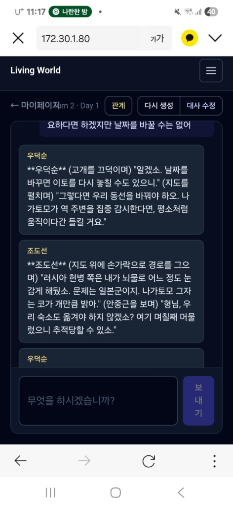
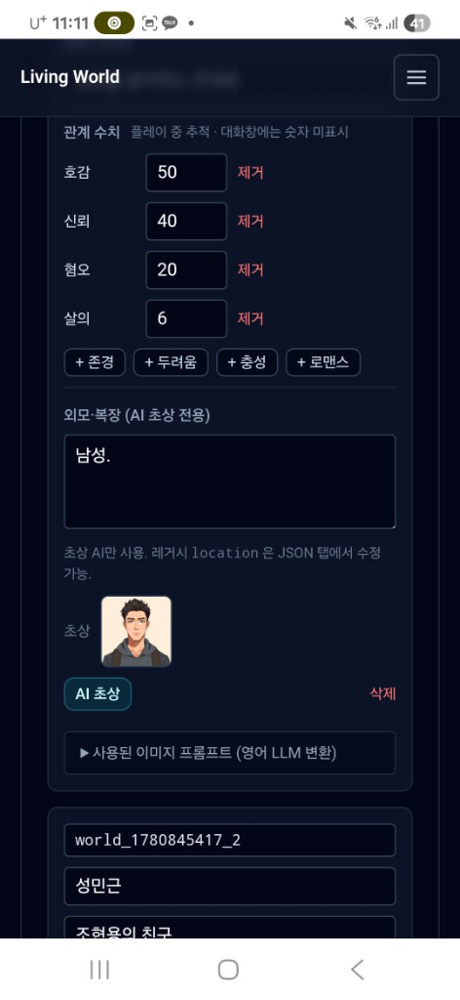
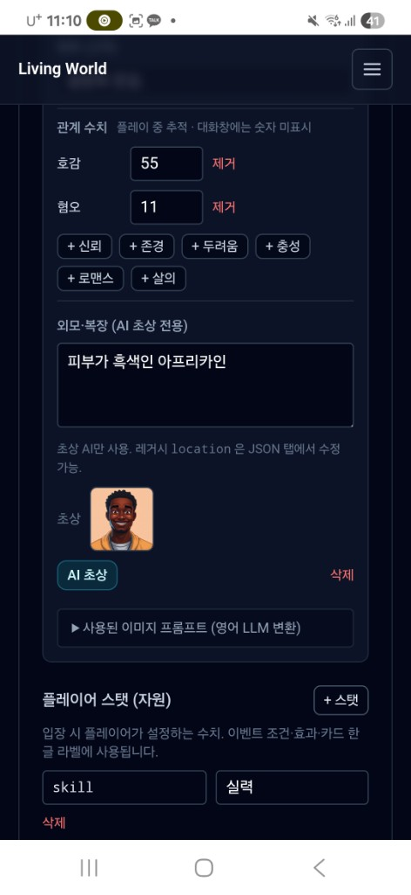
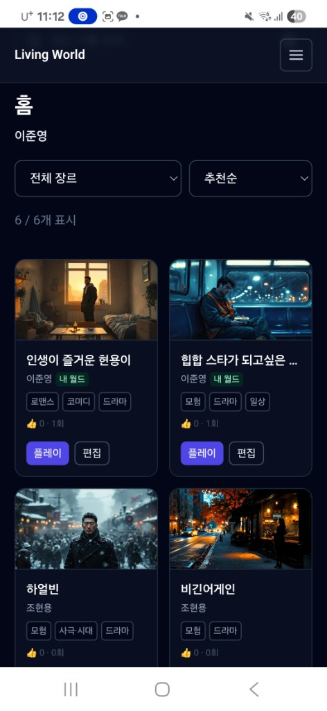
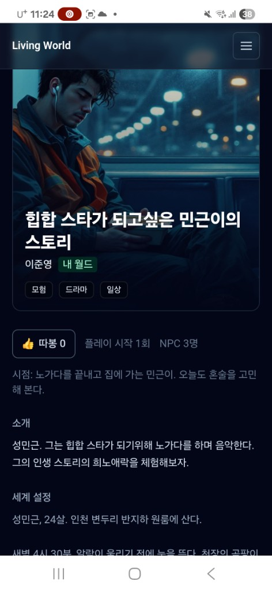
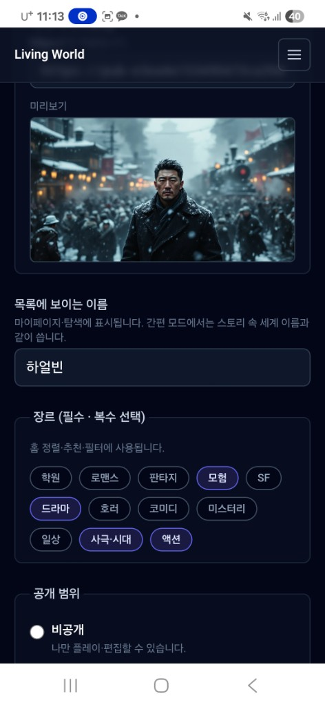
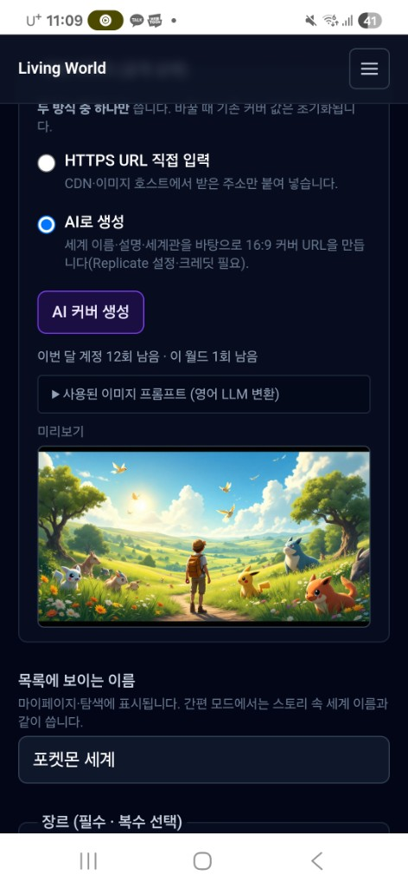

# 🌍 Living World Engine

> **LLM 출력을 신뢰하지 않는 입력으로 다루는 검증·비용 통제 백엔드** — AI 대화형 RPG를 테스트베드로 구현

"LLM은 상태를 제안하고, 시스템이 검증한다": Claude Tool Use로 받은 상태 변경 제안을 Validator가 형식·범위·근거로 걸러서 반영하고, 턴 쿼터·레이트 리밋·비용 집계로 호출량을 통제합니다.

📅 **2025.12 ~ 2026.06** · 🧑‍💻 **1인 풀스택 개발**

[]()
[]()
[]()

---

## 📸 서비스 화면

| 대화 화면 | 월드 상태 | NPC·관계 편집 |
|:---:|:---:|:---:|
|  |  |  |

| 홈 · 탐색 | 월드 상세 | 월드 생성 |
|:---:|:---:|:---:|
|  |  |  |

| 등장인물 | AI 커버 생성 |
|:---:|:---:|
|  |  |

---

## 💡 문제 정의

LLM에 게임 상태를 맡길 때 생기는 문제와 이 프로젝트의 대응:

| 문제 | 원인 | LWE 대응 |
|------|------|----------|
| 장기 기억 소실 | 컨텍스트 윈도우 한계 | **Canon Flags**로 확정 사실을 저장해 매 턴 주입 |
| 상태 모순·오염 | LLM이 상태를 직접 변경 | 상태는 툴 제안으로만 받고 **Validator**가 검증 후 반영 |
| 비용·남용 | 매 턴 긴 프롬프트, 무제한 호출 | **Prompt Caching** + 일일 턴 쿼터·레이트 리밋·비용 집계 |

---

## 🏗 아키텍처

```
┌──────────┐   ┌──────────┐   ┌──────────────┐   ┌────────────┐
│  Client  │──▶│ FastAPI  │──▶│  GameEngine  │──▶│ Claude API │
│ React/TS │   │   API    │   │  (Tool Use)  │   │ Sonnet 4.5 │
└──────────┘   └────┬─────┘   └──────┬───────┘   └────────────┘
                    │                │
              ┌─────┴──────┐  ┌─────┴───────┐
              │ PostgreSQL │  │  Validator  │
              │ 쿼터·비용  │  │ Canon Flags │
              └────────────┘  └─────────────┘
```

### 1턴 8단계 파이프라인

`기억 검색` → `프롬프트 분리` → `Tool Use 호출` → `검증` → `상태 반영` → `이벤트 판정` → `서사 연출` → `화자 분할`

---

## ✨ 핵심 구현

### 🔧 Tool Use (LangChain 미사용)

- `update_game_state` **단일 툴**로 관계 8종 · 플래그 · 능력치 · 기억을 구조화 JSON으로 수신
- 디버깅 가능한 **화이트박스** 제어

### 🚩 Canon Flags

- 대화로 확정된 사실(빚 상환·교제 등)을 플래그로 **영속화**
- 매 턴 동적 프롬프트 앞부분 「지금 사실」 블록에 주입 → 모순 서사를 **프롬프트 수준에서 억제** (LLM 출력을 보장하지는 않음)

### ✅ StateChangeValidator

- 관계 변화량 상한(±3)·턴당 건수·합계 캡, `reason` 필수, flag 키 정규화
- 타입 가드: 스키마와 다른 타입(문자열 숫자, 배열 대신 문자열 등)은 강제 변환하거나 해당 항목만 버리고, 예외로 턴을 깨뜨리지 않음

### 🔄 LoopDetector

- 상태 정체·대사 반복을 감지해 심각도 **0~10** 스코어링 (단위 테스트 있음)
- **구현돼 있으나 현재 게임 루프에서는 비활성화** — 초기 버전의 「severity 7+ → 강제 이벤트 주입」은 정상 대화를 루프로 판정하는 오탐 이력 뒤 2026-03에 꺼 두었고 재평가 전

### 💰 Single-Pass + Prompt Caching

- 1차 응답에 NPC 대사와 `tool_use`가 함께 오면 2차 호출 생략 (`ENABLE_SINGLE_PASS`)
- 시스템 프롬프트를 static/dynamic 블록으로 분리, static 블록에 `cache_control` 적용
- `UsageTracker`가 응답 `usage`(입력·출력·캐시 쓰기·캐시 읽기)로 턴별 추정 비용 기록

### 🛡 비용·남용 통제

- 일일 턴 쿼터: 한도 검사와 차감을 조건부 `UPDATE` 한 문장으로 처리(동시 요청에도 초과 없음), 실패한 턴은 되돌림
- slowapi 레이트 리밋(가입·로그인·턴·이미지 생성, 클라이언트 IP 기준)
- LLM 비용: 일일 추정 비용을 DB에서 원자적으로 집계하고 임계 초과 시 **웹훅 알림만** 보냄(자동 차단 아님). 플레이 중단은 운영자가 `EMERGENCY_SHUTDOWN`으로 수동 실행
- 이미지 생성: 일 예산 초과 시 **요청 차단**(429) + 월별 생성 쿼터

---

## 📊 검증 현황

저장소에서 재현할 수 있는 것만 적었습니다.

- 테스트 **382건 통과** — 유닛 + 스모크, Mock/Stub LLM (`poetry run pytest backend/tests -m "not integration and not e2e"`, CI와 동일)
  - 실제 Claude API가 필요한 통합 5건·e2e 2건은 CI 제외
  - 턴 쿼터·비용 집계 동시성 테스트는 PostgreSQL에서도 실행 가능 (`LWE_TEST_POSTGRES_URL` 설정 시, 기본 skip 2건)
- DB 마이그레이션 **16개** (Alembic, `0001`~`0016`)
- 턴당 비용: `UsageTracker`로 기록하도록 구현했지만 재현 가능한 측정 데이터가 저장소에 없어 수치를 싣지 않습니다

---

## 🛠 기술 스택

| 영역 | 기술 |
|------|------|
| Backend | FastAPI, Python 3.11, Poetry |
| Frontend | React, TypeScript |
| Database | PostgreSQL |
| AI | Claude Sonnet 4.5, Tool Use API |
| Infra | Docker Compose, Sentry |
| Security | JWT 인증, slowapi 레이트 리밋, 일일 턴 쿼터, 비용 알림 웹훅·수동 긴급 셧다운 |
| Test | pytest, Mock/Stub LLM, 382 tests (유닛+스모크) |

---

## 🚀 실행 방법

Docker Compose (PostgreSQL + API + Nginx 웹):

```bash
git clone https://github.com/leejunyoung0610/living-world-engine.git
cd living-world-engine
cp .env.example .env   # ANTHROPIC_API_KEY 입력
docker compose up --build -d
# 웹: http://localhost:8080  ·  API: http://localhost:8000/health
```

- API 컨테이너는 같은 compose의 `db` 서비스를 쓰고, 시작 시 `alembic upgrade head`를 실행합니다. 다른 Postgres를 쓰려면 `.env`에 `DOCKER_DATABASE_URL`을 지정하세요.
- 리버스 프록시 뒤에서 레이트 리밋이 실제 클라이언트 IP로 동작하려면 `FORWARDED_ALLOW_IPS`(신뢰할 프록시 IP/CIDR, 기본 `127.0.0.1`)를 설정하세요 — [docs/DEPLOYMENT.md](docs/DEPLOYMENT.md).

로컬 개발 (PostgreSQL 필요, `.env`의 `DATABASE_URL` 설정):

```bash
poetry install
poetry run python -m alembic upgrade head
poetry run python -m uvicorn backend.src.main:app --reload --port 8000
cd frontend && npm install && npm run dev
# → http://127.0.0.1:5173
```

---

## 📚 문서

| 문서 | 설명 |
|------|------|
| [docs/PORTFOLIO.md](docs/PORTFOLIO.md) | 설계 결정·트레이드오프·한계 정리 |
| [docs/UGC_MVP_PLAN.md](docs/UGC_MVP_PLAN.md) | UGC 베타 MVP 기획 |
| [DEVELOPMENT.md](DEVELOPMENT.md) | 개발 일지 |

---

## 👤 Author

**이준영** — [GitHub @leejunyoung0610](https://github.com/leejunyoung0610)

개인 학습 및 **포트폴리오 목적** 프로젝트입니다.
